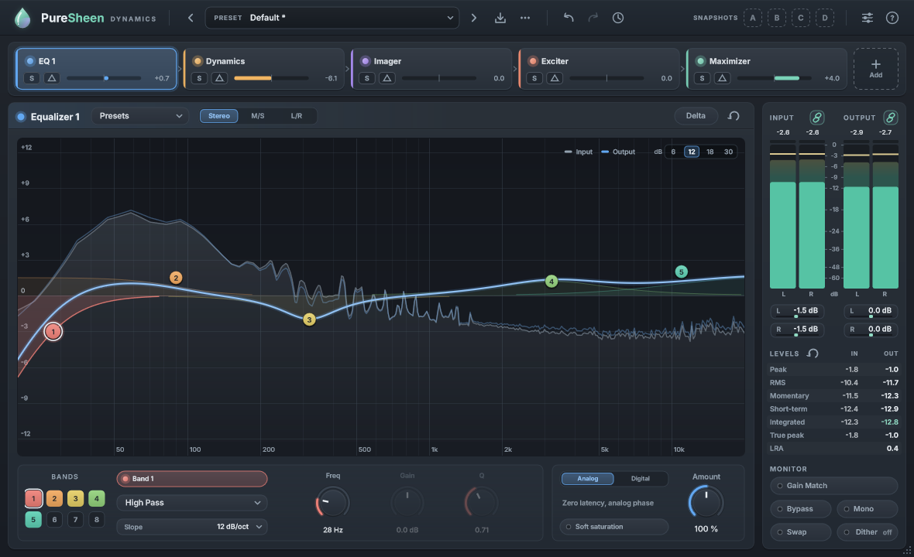

# PureSheen Dynamics

A complete mastering suite in one plugin: two equalizers, multiband dynamics, a stereo imager, a harmonic exciter, a
maximizer and dither, in a chain you can reorder. It has loudness metering, gain-matched bypass, per-module solo and
delta listening, A-D snapshots, undo history and factory presets for common targets (streaming, club, radio).

VST3 + CLAP + Standalone, Windows, built with JUCE 8. Made for FL Studio, works in any DAW.

Every module also comes as a plugin of its own, available in VST3 and CLAP formats: PureSheen Bass Shaper, Smoother, 
Match EQ, Low Contrast, Definition, Punch, Tone Balance, Dynamic EQ, EQ, Multiband Dynamics, Imager, Exciter, Maximizer, 
Dither, Classic Compressor, Passive EQ, Classic Limiter, Tape, and De-limiter. They share their presets seamlessly with the suite.

PureSheen Dynamics is an independent project, not affiliated with or endorsed by any plugin maker. It contains no code
or assets from commercial plugins. Some behaviour was tuned by measuring the audio output of commercial plugins.



## Install

**Download:** every plugin's installer and manual zip are on the [Releases page](https://github.com/Kujar3/PureSheen-Dynamics/releases).

**Everything at once:** run `PureSheen-Complete-Setup-<version>.exe`. It has the suite and every single module, with a
checklist of which ones to install. Run it again later to add or remove plugins. It replaces any separate installs of the
plugins you tick, and your presets stay.

**Installer:** run `PureSheen-Dynamics-Setup-<version>.exe` (or build it yourself with *Building > Installer* below). It installs:
- the VST3 into `C:\Program Files\Common Files\VST3\`
- the CLAP into `C:\Program Files\Common Files\CLAP\`
- optionally, the Standalone app

If FL Studio has the plugin loaded, the installer offers to close it first.

**By hand, without an installer:** unpack `<Name>-<version>-Manual.zip` and follow `How to install.txt` inside. It holds
the `.vst3` folder and the `.clap` file. Copy the folder to `C:\Program Files\Common Files\VST3` (needs admin rights), or
to any folder you add under FL's *Options > Manage plugins > Plugin search paths*.

**From a build:**

1. Build it (see *Building* below).
2. Copy it into the system plugin folders. Run this from the repository folder in PowerShell; it asks for admin once:

   ```
   powershell -ExecutionPolicy Bypass -File scripts\install-plugin.ps1
   ```

   Without admin rights, add `-CurrentUser`. That installs into `%LOCALAPPDATA%\Programs\Common\VST3` and `...\CLAP`.
   Then add those folders in FL's *Options > Manage plugins > Plugin search paths*.
3. In FL Studio, open *Options > Manage plugins* and click *Find installed plugins*. Put **PureSheen Dynamics** in the
   last effect slot of the Master mixer track.

## Using it

The **?** button in the top-right corner explains every part inside the plugin. A short version:

0. **Or let the Assistant start it.** Click the sparkle switch next to the logo, press **Quick** and play the loudest part
   of your song for a few seconds. The Assistant evaluates the incoming audio characteristics to deploy a tailored combination
   of dynamic, corrective, and spatial modules optimized for the detected genre. Instead of forcing a single workflow,
   it generates 6 distinct, editable starting profiles to choose from (such as Gentle, Loud, Warm, Bright & Wide, or Punchy).
   Each choice is saved as an individual undo step, allowing you to fine-tune every module manually.
1. **Start from a preset.** Click the preset name in the header.
   - *Streaming Ready* aims at about -14 LUFS and -1 dBTP.
   - *Loud and Clear* aims at about -9 LUFS, *Club Loud* at about -8 LUFS.
   - *Film and TV -23 LUFS* (-1 dBTP) and *US Broadcast -24 LUFS* (-2 dBTP) only catch peaks. Click **Learn** on the
     Maximizer to bring your mix to the level.
   - Other presets: *Soft Sheen*, *Wide Supersaw Master*, *Deep Bass Anchor*, *Acoustic Air*, *Warm Glue*,
     *Limit Only*, *Radio Pop*, *Rock Drive*, *Hip-Hop Knock*, *Mid-Side Detail*.
   - Every module also has its own presets.
2. **Set the loudness.** Play the loudest part of the song and click **Learn** on the Maximizer. It sets the input gain
   so the song lands on the target next to the button. A song already louder than the target is turned down with
   **Trim** instead.
3. **Compare honestly.** Turn on **Gain Match**, then toggle **Bypass**. Both play at the same loudness, so you judge
   the sound, not the volume. **S** on a module solos it. The **triangle (Delta)** plays only what that module
   changes.
4. **Keep versions.** Snapshots **A-D** store complete settings. The clock icon opens the undo history.
5. **Compare with a reference.** Drop released songs you like (WAV, MP3, FLAC, AIFF or OGG, up to 10) anywhere on
   the plugin, or open the **Reference** page from the switch next to the logo.
   - The **reference button** in the header switches between your master and the selected reference. Level match
     plays the reference at your master's loudness, so you hear the difference in sound, not in volume.
   - **Loops A-E**: drag across the waveform to mark up to five sections per reference (the drop, a breakdown...),
     then click a letter to play that section. Click it again for the whole track.
   - The page compares your master with the reference: tonal balance per band, loudness, peaks and dynamics, stereo
     width and mono bass, with a short list of what to try in PureSheen's modules.
   - The analysers show the reference's spectrum as a lavender line (Options menu to turn it off).
   - The Assistant can use any of these references as its target ("Ref: ..." in its target list).
   - The project remembers the references, their loops and the settings, but not the audio: keep the files where
     they are. A moved file shows as missing; click it to find it again.

The modules (drag them in the chain strip to reorder, **Add** for more):

- **Equalizer 1 / 2**: up to 8 bands per channel set (Stereo, Mid/Side or Left/Right).
  - Shapes: bells, shelves (analog, Baxandall, vintage, resonant, band), high / low cuts up to 48 dB/oct (flat or
    resonant), brickwall cuts, and surgical bands.
  - Analog mode has zero latency. Digital mode is linear-phase (FIR 4096-32768), with a phase blend.
  - Also: soft saturation, Amount, and band audition (Alt-drag).
- **Dynamics**: 1-4 bands, each with a compressor and a limiter.
  - Envelope, peak or RMS detection, a detection filter with tilt, lookahead.
  - Adaptive release, auto gain, and a transfer-curve view.
- **Imager**: width per band, Stereoize (two flavours), Recover Sides and Prevent antiphase.
  - A vectorscope (polar sample, polar level, Lissajous) with a correlation history.
- **Exciter**: 7 saturation models per band (Analog, Retro, Tape, Tube, Warm, Triode, Dual Triode), drive and mix.
  - 4x oversampling and a post filter.
- **Maximizer**: six limiter modes (Low Latency, Smooth, Transparent, Aggressive, Spectral, Multiband).
  - True peak, soft clip, transient emphasis, stereo independence and upward lift.
  - Learn input gain to a LUFS target.
- **Dither**: for 16-bit exports. Bit depth, noise shaping, harmonic suppression and auto-blank on silence.
- **I/O**: input / output meters and gain, and peak, RMS, momentary, short-term, integrated, true peak and LRA
  readouts.
  - Mono, Swap, Bypass and Gain Match monitoring.

## Working with Claude

Claude Desktop or Claude Code can read PureSheen Dynamics' meters and settings and adjust it, over MCP. The single-module
plugins don't have this.

1. In the plugin, open Options (the sliders button) > Claude and turn on **Allow Claude to connect**. It's off by default.
2. From the same menu, copy the setup for your Claude app.
   - Claude Desktop: Settings > Developer > Edit Config, merge the copied text into that file, and restart Claude.
   - Claude Code: run the copied command in a terminal, then start a new session.
3. Play your track and ask Claude something like "How loud is this master, and how does it compare with my reference?"

Claude can change settings and the module chain, load and save presets, run the Assistant, and compare with reference tracks.
Each change to settings or the chain is one undo step in the History, labelled "Claude:", and that includes results that arrive
later, from the Assistant or Learn. Bypass and Gain Match stay with you. Claude can't hear your music or start playback,
so you press play and you judge the result.

The connection only accepts programs on your own PC that hold this instance's token. The installer's connector is the small
program `PureSheenBridge.exe`, which Claude starts. You can leave it out in the installer's custom setup, and the plugin works
the same without it.

## Building

You need Visual Studio 2022 with *Desktop development with C++*, plus CMake and Ninja (`pip install cmake ninja`).
JUCE 8.0.16 goes in `third_party/JUCE`:

```
git clone --depth 1 --branch 8.0.16-security https://github.com/juce-framework/JUCE.git third_party/JUCE
scripts\fetch_clap.bat
scripts\build.bat build PureSheen_VST3 PureSheen_CLAP PureSheen_Standalone CoreTests PureSheenDev
```

`fetch_clap.bat` adds the optional CLAP build. Then run the checks:

- `build\CoreTests.exe`: DSP unit tests (filters, crossovers, oversampling, convolution, every module), measured
  against reference responses, null tests and true-peak limits
- `build\PureSheenDev_artefacts\Release\PureSheenDev.exe selftest`: processor-level integration tests (latency,
  nulls, state, presets, undo, and no allocation on the audio thread)
- `build\PureSheenDev_artefacts\Release\PureSheenDev.exe snapshot out\snaps`: renders the UI to PNGs
- `build\PureSheenDev_artefacts\Release\PureSheenDev.exe render in.wav out.wav --preset "Streaming Ready"`: offline
  render with loudness / true peak / LRA readout
- `tools\pluginval\pluginval.exe --strictness-level 10 --validate "build\PureSheen_artefacts\Release\VST3\PureSheen Dynamics.vst3"`

### Installer

The installer is built with [Inno Setup 6](https://jrsoftware.org/isinfo.php) from a static-runtime build, so the
target machine needs no Visual C++ redistributable. One command builds it:

```
scripts\build-installer.bat
```

The setup lands in `dist\`. Its version is the `project()` version in `CMakeLists.txt`.
`scripts\build-installer.bat /DTestRoot=C:\Temp\puresheen-test` builds a test variant instead. It installs per user,
under that folder.

Every plugin, the suite and the single-module ones (`installer\products.csv`), with an installer and a manual zip each,
plus the all-in-one installer:

```
powershell -ExecutionPolicy Bypass -File scripts\package-all.ps1
```

`-Only eq,tape` limits it to those plugins, `-CompleteOnly` makes only the all-in-one installer, `-SkipBuild` packages
what is already built, and `-TestRoot <folder>` builds test installers as above. A single plugin builds with `scripts\build.bat build PureSheen_eq_VST3 PureSheen_eq_CLAP`.

See `ARCHITECTURE.md` for how the code is organised.

## Licence

PureSheen Dynamics and its single-module plugins are Copyright (C) 2026 Kujar3. They are free software under the
[GNU Affero General Public License v3](LICENSE), with no warranty.

In plain words:

- You can use them for anything, including commercial music, for free.
- You can change them, share them and even sell them. Whoever shares or sells a build must also give the people who get
  it the complete source code, including their changes, under this same licence. The same goes for a changed version
  that people use over a network.
- A closed-source product built on this code is not allowed under this licence. It would need separate commercial permission
  from the copyright holder for this code, and a corresponding commercial [JUCE licence](https://juce.com/get-juce/) from JUCE.

If this summary and the licence differ, the licence decides.

Built with:

- [JUCE 8](https://juce.com), used under the AGPLv3 (it is dual-licensed, with a commercial licence as the alternative).
- From JUCE: the VST3 SDK (MIT), FLAC and Ogg Vorbis (BSD), jpeglib, libpng and zlib, HarfBuzz, SheenBidi (Apache 2.0).
- [clap-juce-extensions](https://github.com/free-audio/clap-juce-extensions) and CLAP (MIT).
- The [Inter](https://rsms.me/inter/) font (SIL Open Font License 1.1).

Their notices are in [`installer/THIRD-PARTY-NOTICES.txt`](installer/THIRD-PARTY-NOTICES.txt), and every installer and
zip carries that file and the licence. The logo is drawn in code (`PureSheenDev icon`). VST is a registered trademark of
Steinberg Media Technologies GmbH.
